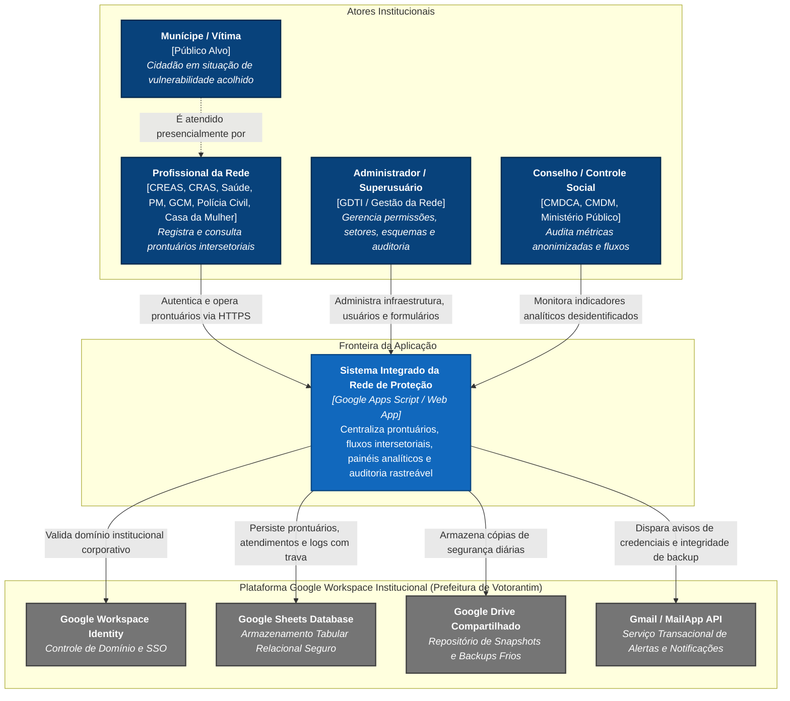
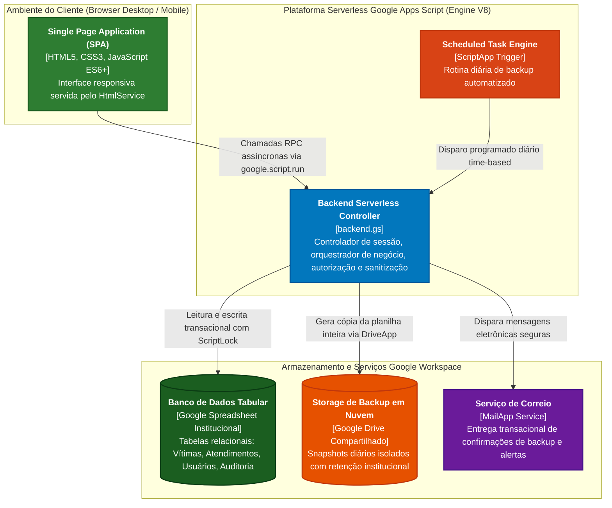
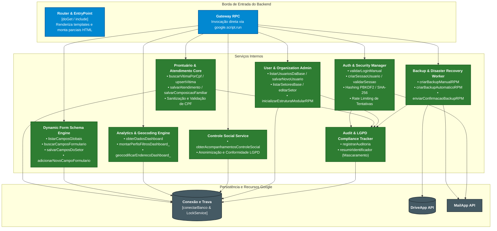
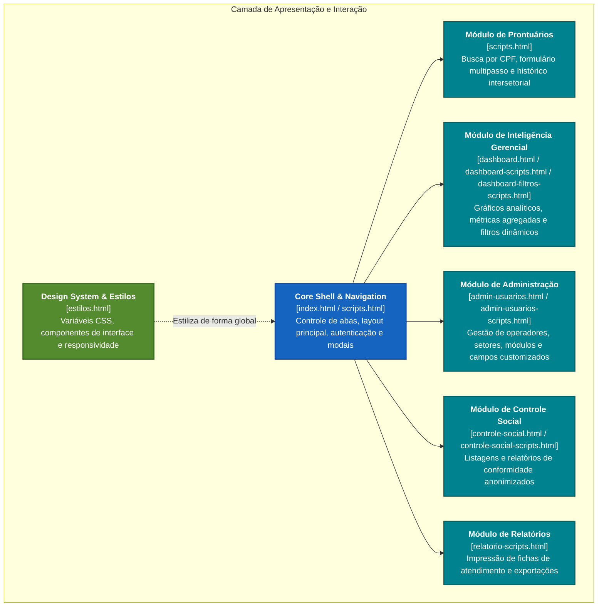
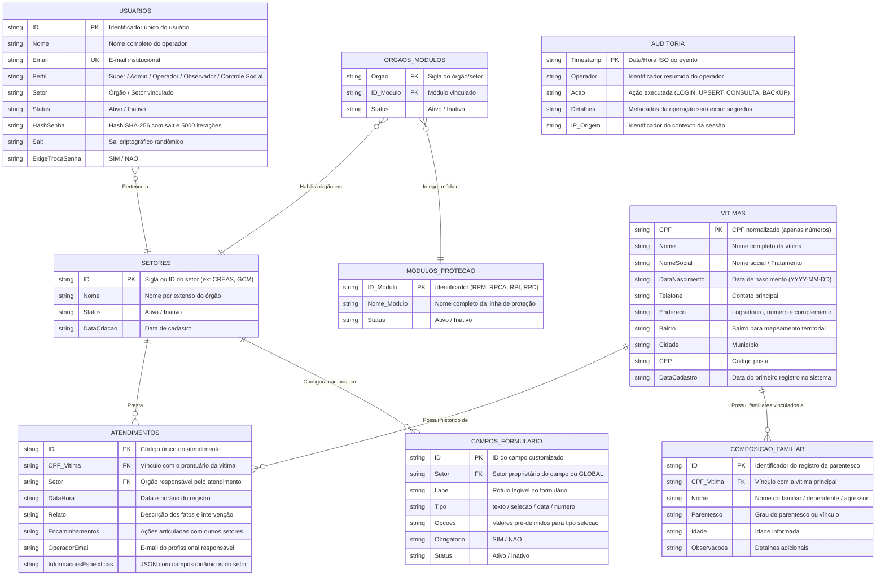
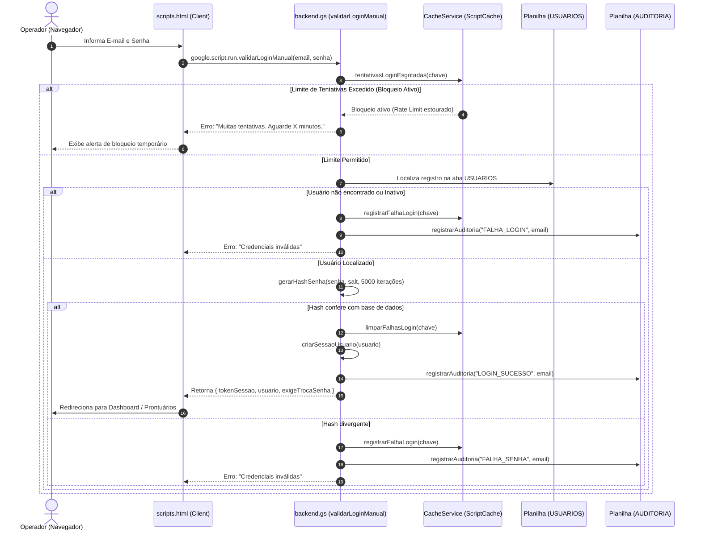
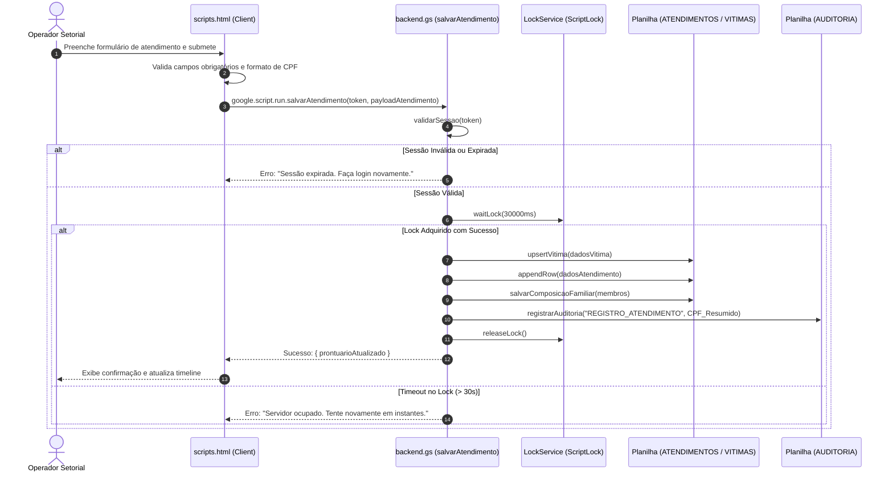
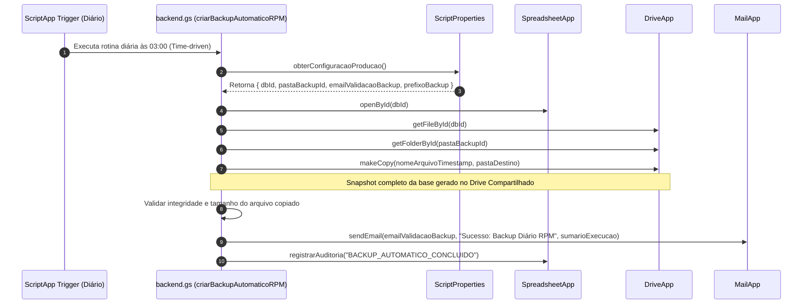
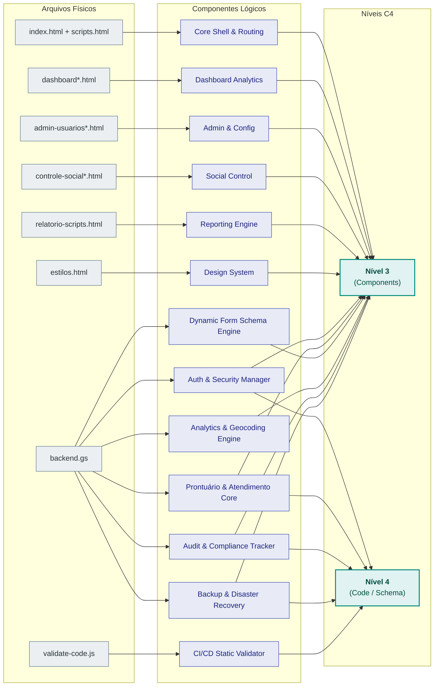

[-0969da?style=for-the-badge)](ARQUITETURA.md)

---

# Arquitetura do Sistema — Modelo C4

Especificação arquitetural formal do **Sistema Integrado da Rede de Proteção (RPM - Votorantim)**, estruturada através dos 4 níveis do **Modelo C4** (*Context, Containers, Components, Code*).

| Componente | Tecnologia | Papel no Sistema |
| --- | --- | --- |
| Interface | HTML5, CSS3 e JavaScript ES6+ | SPA servida via Apps Script HtmlService |
| Backend | Google Apps Script (`backend.gs`) | Regras de negócio, segurança e roteamento RPC |
| Base de dados | Google Sheets institucional | Armazenamento relacional estruturado em abas |
| Arquivos e backups | Google Drive institucional | Snapshots diários e persistência em Drive Compartilhado |
| Mensageria | Gmail / MailApp Service | Alertas transacionais de integridade e primeiro acesso |
| Execução | Web App Google Apps Script | Aplicação serverless restrita ao domínio institucional |

---

## 1. Contexto do Sistema (System Context)

### Atores e Interações

- **Profissional da Rede Intersetorial (Operador):** Usuários dos órgãos vinculados (CREAS, CRAS, Saúde, PM, GCM, Polícia Civil, Casa da Mulher) que registram atendimentos, histórico de violência e composição familiar.
- **Administrador Técnico (Superusuário):** Gestor do sistema (`RPM_EMAIL_SUPER_USUARIO`) com privilégio para cadastrar operadores, setores, módulos de proteção e campos personalizados.
- **Controle Social (Conselhos e Órgãos Fiscalizadores):** Acesso desidentificado para acompanhamento de métricas agregadas sem exposição de dados pessoais.
- **Munícipe / Vítima:** Titular dos dados pessoais sensíveis protegidos pela Lei Geral de Proteção de Dados (Lei nº 13.709/2018).

---

## 2. Contêineres (Containers)

### Matriz de Tecnologias e Protocolos

| Contêiner | Tecnologia | Papel e Responsabilidade | Protocolo de Integração |
|---|---|---|---|
| **Frontend Web (SPA)** | HTML5, CSS3, JavaScript V8 | Interface de usuário, navegação por abas, validação prévia de formulários e controle de sessão no cliente. | HTTPS / RPC nativo `google.script.run` |
| **Backend Serverless** | Google Apps Script (Engine V8 / `backend.gs`) | Regras de negócio, autenticação com PBKDF2/SHA-256, autorização RBAC, controle de concorrência (`LockService`) e auditoria. | Execução gerenciada no Google Cloud |
| **Agendador (Cron)** | Google Apps Script `ScriptApp` Triggers | Gatilho temporal diário (`configurarBackupAutomaticoRPM`) para backup autônomo. | Evento temporal do Google Scheduler |
| **Banco de Dados** | Google Sheets (`RPM_DB_ID`) | Camada de persistência relacional modelada em abas com bloqueio concorrencial por script. | SpreadsheetApp API |
| **Storage de Backups** | Google Drive (`RPM_PASTA_BACKUP_ID`) | Armazenamento de cópias de segurança integrais em Drive Compartilhado restrito. | DriveApp API |
| **Serviço de E-mail** | Gmail / MailApp | Disparo de alertas operacionais (`RPM_EMAIL_VALIDACAO_BACKUP`) e avisos de acesso. | MailApp API |

---

## 3. Componentes (Components)

### Componentes do Backend (`backend.gs`)

### Componentes da Interface Web (Frontend)

---

## 4. Código e Modelagem de Dados (Code & Data Model)

### Modelo de Entidade-Relacionamento das Abas (Spreadsheet ERD)

A planilha Google Sheets opera como um banco de dados relacional com integridade referencial mantida via código:

---

### Fluxos Críticos de Execução

#### 1. Autenticação, Hashing e Rate Limiting

#### 2. Registro Transacional de Atendimento com Bloqueio de Concorrência

#### 3. Pipeline de Backup Automatizado

---

## Matriz de Rastreabilidade

Mapeamento entre arquivos físicos, componentes lógicos e níveis da arquitetura:

| Artefato Físico | Nível C4 | Componente Lógico Associado | Funções Críticas de Entrada |
|---|---|---|---|
| `backend.gs` | Nível 3 & 4 | `Auth & Security Manager` | `validarLoginManual`, `criarSessaoUsuario`, `validarSessao`, `gerarHashSenha`, `tentativasLoginEsgotadas` |
| `backend.gs` | Nível 3 & 4 | `Prontuário & Atendimento Core` | `buscarVitimaPorCpf`, `upsertVitima`, `salvarAtendimento`, `salvarComposicaoFamiliar`, `salvarEdicaoCadastroVitima` |
| `backend.gs` | Nível 3 & 4 | `Dynamic Form Schema Engine` | `listarCamposGlobais`, `buscarCamposFormulario`, `adicionarNovoCampoFormulario`, `salvarCamposDoSetor` |
| `backend.gs` | Nível 3 & 4 | `Analytics & Geocoding Engine` | `obterDadosDashboard`, `montarPerfisFiltrosDashboard_`, `geocodificarEnderecoDashboard_` |
| `backend.gs` | Nível 3 & 4 | `Audit & Compliance Tracker` | `registrarAuditoria`, `resumirIdentificador`, `normalizarCpfsBaseRPM` |
| `backend.gs` | Nível 3 & 4 | `Backup & Disaster Recovery` | `criarBackupManualRPM`, `criarBackupAutomaticoRPM`, `configurarBackupAutomaticoRPM` |
| `index.html` / `scripts.html` | Nível 3 | `Core Shell & Routing Manager` | Gerenciamento de abas, ciclo de vida do DOM, modal de troca de senha, formulários de prontuário |
| `dashboard*.html` | Nível 3 | `Dashboard Analytics Component` | Renderização de gráficos, filtros multidimensionais e indicadores setoriais |
| `admin-usuarios*.html` | Nível 3 | `Administration & Config` | Painel de controle de operadores, permissões, ativação de módulos e campos setoriais |
| `controle-social*.html` | Nível 3 | `Social Control & Transparency` | Visualização de dados agregados/anonimizados para conselheiros municipais |
| `relatorio-scripts.html` | Nível 3 | `Reporting & Export Engine` | Impressão e exportação de relatórios estruturados |
| `estilos.html` | Nível 3 | `Design System & Token Store` | Definição de tokens de cores, layout responsivo, tipografia e componentes acessíveis |
| `validate-code.js` | Nível 4 | `CI/CD Static Code Validator` | Validação de sintaxe, testes de integridade estrutural e prevenção de regressões |

