# Sistema Integrado da Rede de Proteção — Votorantim

Aplicação institucional para registro, acompanhamento e gestão de atendimentos da Rede de Proteção. O sistema centraliza informações de vítimas, atendimentos, setores envolvidos, relatórios e painéis gerenciais.

> **Dados sensíveis:** este repositório contém código de um sistema que trata dados pessoais. Nunca envie planilhas de produção, backups, credenciais, IDs de arquivos do Google Drive ou dados de usuários ao GitHub.

---

## Funcionalidades

- autenticação de usuários e perfis de acesso;
- cadastro e consulta de prontuários;
- registro de atendimentos por setor;
- gestão de usuários, setores e campos de formulário;
- painel gerencial e relatórios;
- acompanhamento para controle social;
- trilha de auditoria;
- backups manuais e automáticos da base de dados.

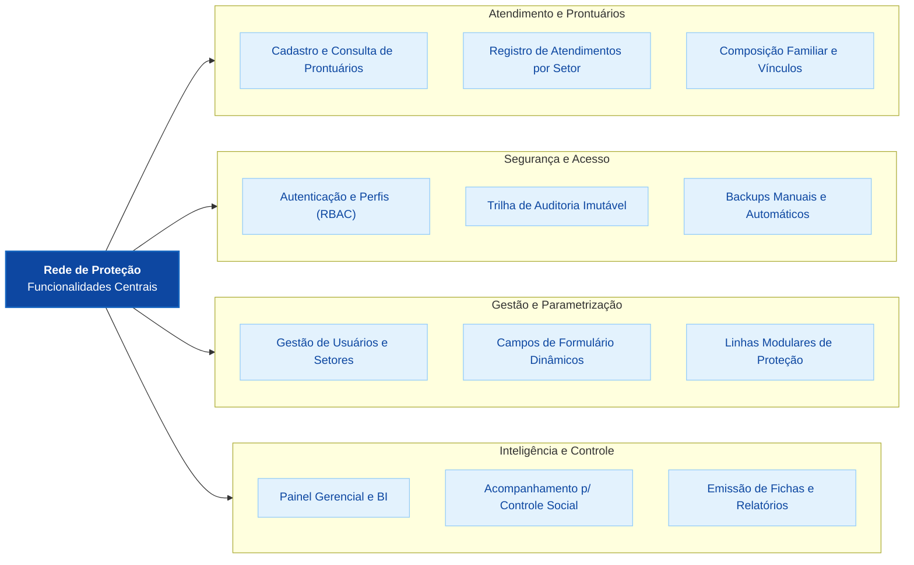

---

## Arquitetura

O projeto é uma aplicação Web do **Google Apps Script**.

| Componente | Tecnologia |
| --- | --- |
| Interface | HTML, CSS e JavaScript, servido pelo Apps Script |
| Backend | Google Apps Script (`backend.gs`) |
| Base de dados | Google Sheets institucional |
| Arquivos e backups | Google Drive institucional |
| E-mails | Gmail/Google Workspace via Apps Script |
| Publicação | Web App do Google Apps Script |

---

## Estrutura do repositório

| Arquivo | Finalidade |
| --- | --- |
| `backend.gs` | regras de negócio, persistência, auditoria, permissões e backups |
| `index.html` | interface principal e autenticação |
| `scripts.html` | scripts da interface principal |
| `admin-usuarios*.html` | administração de usuários e configurações |
| `dashboard*.html` | painel gerencial e filtros |
| `controle-social*.html` | módulo de controle social |
| `relatorio-scripts.html` | geração de relatórios |
| `estilos.html` | estilos compartilhados |
| `appsscript.json` | manifesto e permissões do Apps Script |
| `validate-code.js` | validações estáticas do projeto |

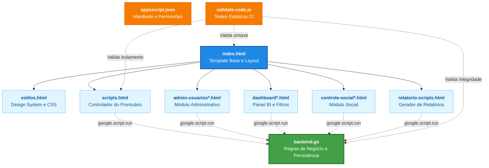

---

## Requisitos

- Node.js 18 ou superior;
- conta Google Workspace institucional com acesso ao Apps Script, Sheets, Drive e Gmail;
- permissões de edição no projeto Apps Script de destino;
- `@google/clasp` para sincronizar o código com o Apps Script.

---

## Instalação e validação local

```bash
npm install
node validate-code.js
```

O comando de validação verifica a sintaxe dos arquivos e invariantes essenciais. Ele não acessa nem altera dados do Google Workspace.

---

## Configuração no Google Workspace

A produção deve ser operada por uma conta técnica institucional. Os valores de ambiente ficam em **Configurações do projeto > Propriedades do script** e não devem ser colocados no código:

| Propriedade | Descrição |
| --- | --- |
| `RPM_DB_ID` | ID da planilha institucional de produção |
| `RPM_EMAIL_SUPER_USUARIO` | e-mail institucional do administrador principal |
| `RPM_PASTA_BACKUP_ID` | ID da pasta institucional de backups |
| `RPM_EMAIL_VALIDACAO_BACKUP` | caixa institucional para avisos de backup |
| `RPM_PREFIXO_BACKUP` | prefixo opcional dos arquivos de backup |

O Web App deve ser publicado com estas opções:

- **Executar como:** usuário que fez a implantação;
- **Quem tem acesso:** somente usuários do domínio da Prefeitura.

O roteiro completo está em [MIGRACAO_GOOGLE_WORKSPACE.md](MIGRACAO_GOOGLE_WORKSPACE.md).

---

## Desenvolvimento e publicação

1. Trabalhe em uma branch própria.
2. Execute `node validate-code.js` antes de criar um commit.
3. Faça revisão de código antes de enviar alterações à branch principal.
4. Publique primeiro em homologação e valide com contas institucionais de teste.
5. Crie uma nova versão e implantação do Web App para produção após aprovação da TI e do responsável pela LGPD.

> O arquivo `.clasp.json` identifica um projeto Apps Script específico. Não reutilize o identificador de desenvolvimento para produção e não versione arquivos com credenciais.

```mermaid
flowchart LR
    classDef step fill:#f5f5f5,stroke:#bdbdbd,stroke-width:1px,color:#212121;
    classDef gate fill:#fff3e0,stroke:#ff9800,stroke-width:2px,color:#e65100;
    classDef success fill:#e8f5e9,stroke:#4caf50,stroke-width:2px,color:#1b5e20;

    B1["1. Branch de Trabalho<br/><code>feature/minha-alteracao</code>"]:::step
    B2["2. Validação Local<br/><code>node validate-code.js</code>"]:::gate
    B3["3. Pull Request e<br/>Revisão de Código"]:::step
    B4["4. Deploy Homologação<br/>(clasp push / testes)"]:::step
    B5["5. Aprovação TI e LGPD"]:::gate
    B6["6. Deploy em Produção<br/>(Nova Implantação)"]:::success

    B1 --> B2
    B2 -->|Passou| B3
    B3 --> B4
    B4 --> B5
    B5 -->|Aprovado| B6
```

---

## Segurança e LGPD

- Use contas individuais e institucionais; nunca compartilhe senhas.
- Mantenha planilha, backups e projeto Apps Script em ambientes institucionais com acesso mínimo necessário.
- Não publique a base de dados, backups ou exports em repositórios, e-mails ou links públicos.
- Revise periodicamente usuários, permissões do Drive, perfis administrativos e registros de auditoria.
- Revogue acessos imediatamente quando uma pessoa deixar a equipe ou mudar de função.

---

## Suporte e governança

Para mudanças em produção, registre a solicitação com a equipe de TI responsável e obtenha validação das áreas gestora e de proteção de dados quando a alteração impactar dados, perfis de acesso ou fluxo de atendimento.

---

## Licença

Uso institucional. A distribuição, reutilização ou divulgação depende de autorização da Prefeitura de Votorantim.

---

# Documentação Arquitetural — Modelo C4

Esta seção formaliza a arquitetura de engenharia do **Sistema Integrado da Rede de Proteção (RPM - Votorantim)** empregando o **Modelo C4** (*Context, Containers, Components, Code*), decompondo a solução desde sua relação com atores externos até os detalhes de fluxo algorítmico e esquemas relacionais no Google Workspace.

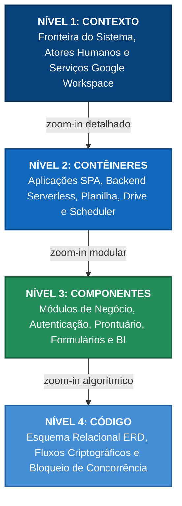

---

## C4 — Nível 1: Diagrama de Contexto (System Context)

O nível de Contexto descreve o posicionamento do sistema em relação aos atores humanos e às fronteiras de sistemas integrados da infraestrutura governamental e do ecossistema Google Workspace.

### Diagrama de Contexto do Sistema

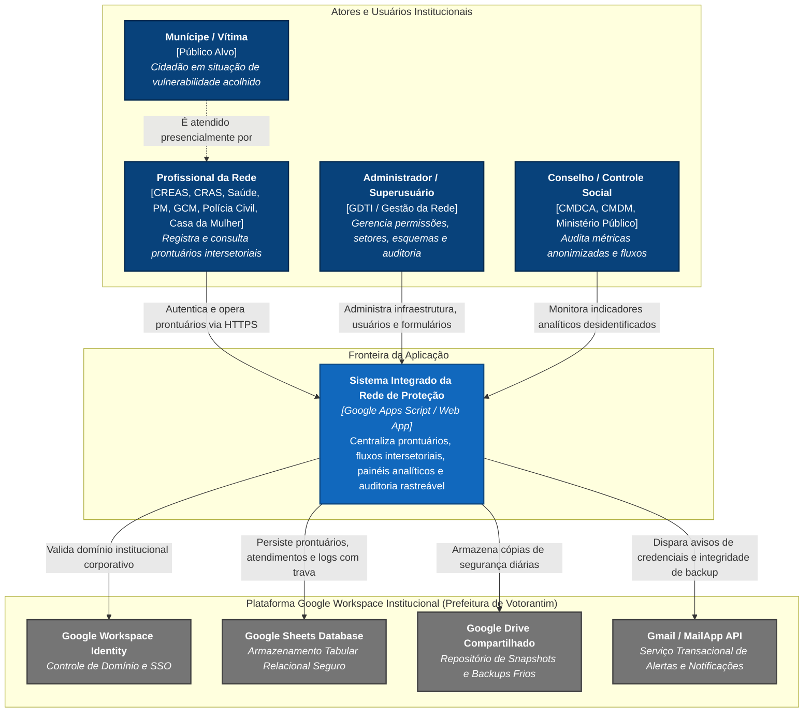

### Detalhamento dos Atores e Interações de Contexto

1. **Profissional da Rede Intersetorial (Operador):**
   - Atuantes nos órgãos cadastrados: CREAS, CRAS, Saúde, Polícia Militar (PM), Guarda Civil Municipal (GCM), Polícia Civil, Casa da Mulher, etc.
   - Operam autenticados sob controle de perfil (RBAC), criando e atualizando cadastros de vítimas, histórico familiar e relatórios de acolhimento.
2. **Administrador Técnico e Funcional (Superusuário):**
   - Usuário institucional com poderes absolutos definidos via `RPM_EMAIL_SUPER_USUARIO`.
   - Executa a manutenção de setores, ativação de módulos de proteção (`RPM`, `RPCA`, `RPI`, `RPD`), campos dinâmicos, credenciais e auditoria.
3. **Controle Social e Órgãos Fiscalizadores:**
   - Visualizam métricas consolidadas e listas anonimizadas/desidentificadas em conformidade com a LGPD, garantindo transparência pública sem exposição de dados pessoais.
4. **Munícipe / Vítima:**
   - Titular dos dados sensíveis protegidos pela Lei Geral de Proteção de Dados (Lei nº 13.709/2018).

---

## C4 — Nível 2: Diagrama de Contêineres (Containers)

O nível de Contêineres detalha as unidades de execução de software, os armazenamentos de dados e os protocolos de comunicação utilizados na solução.

### Diagrama de Contêineres

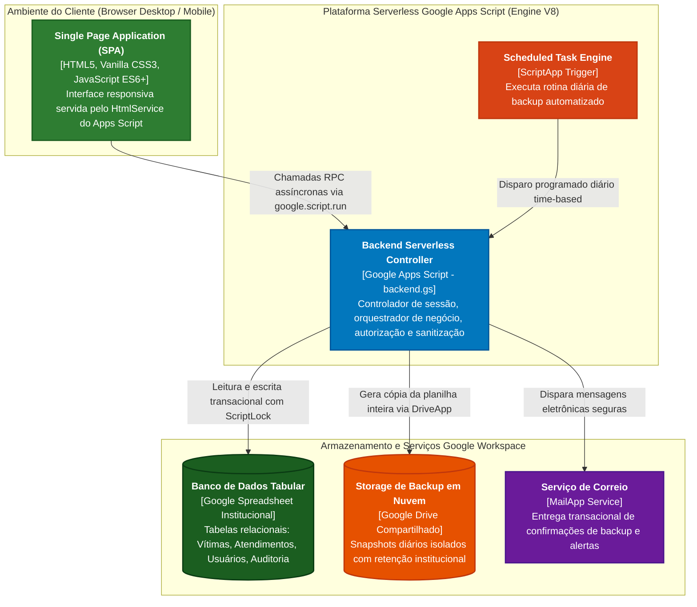

### Matriz de Contêineres e Tecnologias

| Contêiner | Tecnologia | Papel e Responsabilidade | Protocolo de Integração |
|---|---|---|---|
| **Frontend Web (SPA)** | HTML5, CSS3, JavaScript V8 | Interface com o usuário, renderização dinâmica de telas, validação prévia de formulários, controle de máscaras e gestão do token de sessão no cliente. | HTTPS / RPC nativo `google.script.run` |
| **Backend Serverless** | Google Apps Script (Engine V8 / `backend.gs`) | Ponto único de entrada, gerenciamento de autenticação, hashing de senhas, validações de negócio, concorrência (`LockService`) e auditoria. | Execução interna gerenciada pelo Google Cloud |
| **Agendador (Cron)** | Google Apps Script `ScriptApp` Triggers | Gatilho temporal diário (`configurarBackupAutomaticoRPM`) que executa o processo de salvaguarda de dados sem intervenção humana. | Invocação interna por evento do Google Scheduler |
| **Banco de Dados** | Google Sheets (`RPM_DB_ID`) | Camada de persistência relacional modelada em abas com bloqueio concorrencial por script. | SpreadsheetApp API (Google Workspace) |
| **Storage de Backups** | Google Drive (`RPM_PASTA_BACKUP_ID`) | Repositório isolado em Drive Compartilhado para snapshots imutáveis com retenção controlada. | DriveApp API (Google Workspace) |
| **Serviço de E-mail** | Gmail / MailApp | Disparo de alertas operacionais para `RPM_EMAIL_VALIDACAO_BACKUP` e notificações de primeiro acesso. | MailApp API (Google Workspace) |

---

## C4 — Nível 3: Diagrama de Componentes (Components)

O nível de Componentes decompõe os contêineres de Frontend e Backend em seus módulos lógicos de responsabilidade única.

### Componentes do Backend (`backend.gs`)

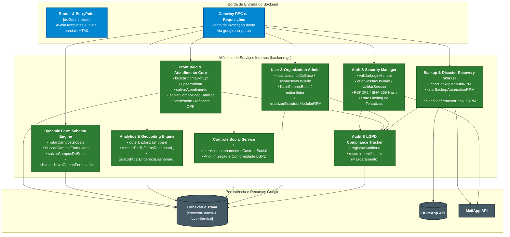

### Componentes da Camada Frontend (Interface Web)

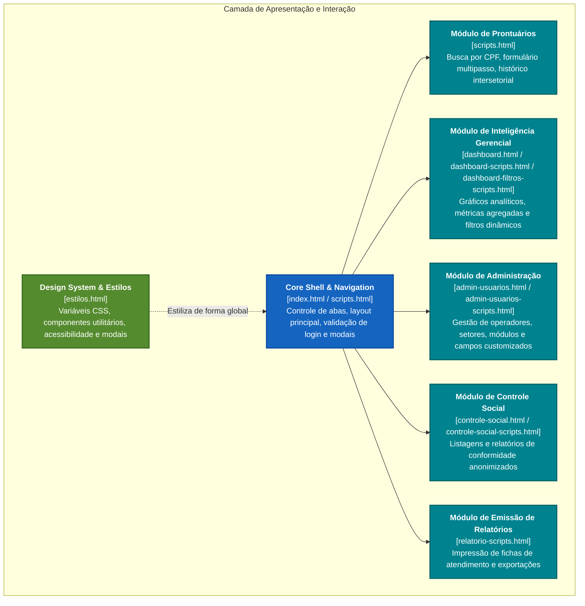

---

## C4 — Nível 4: Código e Implementação (Code / ERD / Sequence)

O nível de Código aprofunda a implementação em quatro dimensões fundamentais:
1. **Modelagem Relacional das Abas do Google Sheets (ERD)**;
2. **Ciclo de Vida e Segurança da Autenticação (PBKDF2/SHA-256 + Rate Limit)**;
3. **Fluxo Transacional de Registro de Atendimento com Concorrência (`LockService`)**;
4. **Pipeline Automatizado de Backup e Resiliência Operacional**.

### 1. Modelo de Entidade-Relacionamento das Abas (Spreadsheet ERD)

A base de dados opera em uma planilha Google Sheets estruturada como um banco de dados relacional tabular:

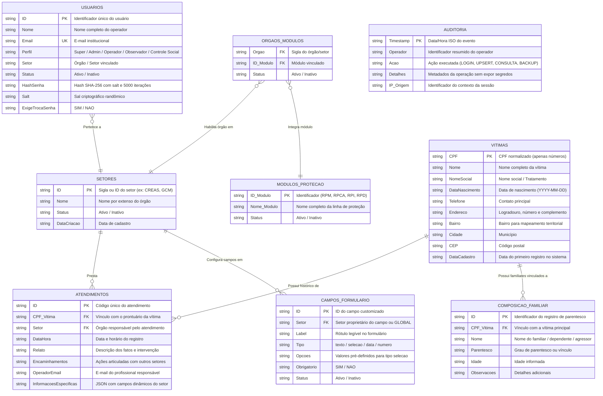

---

### 2. Fluxo de Autenticação, Hashing e Mitigação de Força Bruta

O sistema implementa uma camada de autenticação com derivação de chave iterativa (5.000 iterações de SHA-256) e bloqueio exponencial por IP/usuário via `CacheService`:

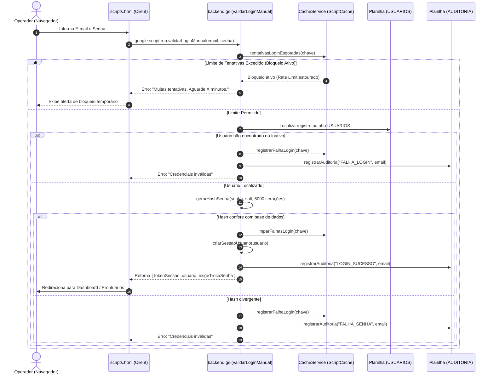

---

### 3. Fluxo de Atendimento com Concorrência e Bloqueio de Script (`LockService`)

Como o Google Sheets não possui mecanismos de bloqueio de linha nativo via API, o backend protege escritas concorrentes por meio do `LockService.getScriptLock()`:

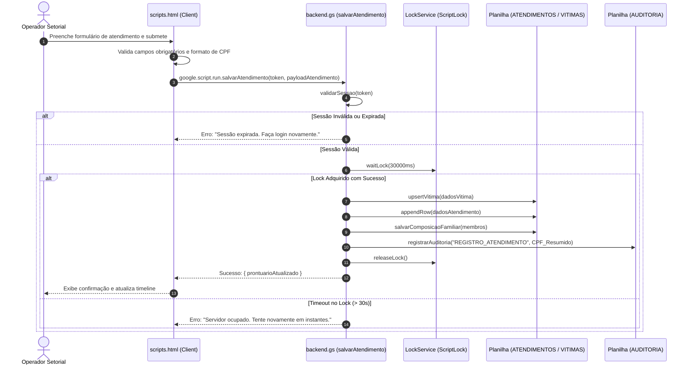

---

### 4. Pipeline de Backup Automatizado e Salvaguarda Institucional

O processo de disaster recovery opera em background, disparado diariamente pelo acionador temporal institucional do Apps Script:

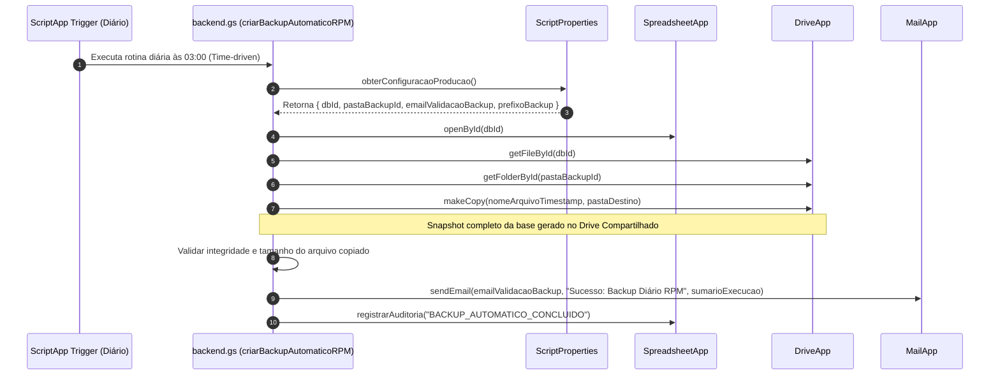

---

## Matriz de Rastreabilidade: Código vs. Componentes C4

Para assegurar integridade no ciclo de vida de manutenção e desenvolvimento do sistema, a tabela abaixo mapeia cada arquivo físico e bloco funcional do repositório aos seus respectivos níveis do modelo C4:

| Artefato Físico | Nível C4 | Componente Lógico Associado | Funções Críticas de Entrada |
|---|---|---|---|
| `backend.gs` | Nível 3 & 4 | `Auth & Security Manager` | `validarLoginManual`, `criarSessaoUsuario`, `validarSessao`, `gerarHashSenha`, `tentativasLoginEsgotadas` |
| `backend.gs` | Nível 3 & 4 | `Prontuário & Atendimento Core` | `buscarVitimaPorCpf`, `upsertVitima`, `salvarAtendimento`, `salvarComposicaoFamiliar`, `salvarEdicaoCadastroVitima` |
| `backend.gs` | Nível 3 & 4 | `Dynamic Form Schema Engine` | `listarCamposGlobais`, `buscarCamposFormulario`, `adicionarNovoCampoFormulario`, `salvarCamposDoSetor` |
| `backend.gs` | Nível 3 & 4 | `Analytics & Geocoding Engine` | `obterDadosDashboard`, `montarPerfisFiltrosDashboard_`, `geocodificarEnderecoDashboard_` |
| `backend.gs` | Nível 3 & 4 | `Audit & Compliance Tracker` | `registrarAuditoria`, `resumirIdentificador`, `normalizarCpfsBaseRPM` |
| `backend.gs` | Nível 3 & 4 | `Backup & Disaster Recovery` | `criarBackupManualRPM`, `criarBackupAutomaticoRPM`, `configurarBackupAutomaticoRPM` |
| `index.html` / `scripts.html` | Nível 3 | `Core Shell & Routing Manager` | Gerenciamento de abas, ciclo de vida do DOM, modal de troca de senha, formulários de prontuário |
| `dashboard*.html` | Nível 3 | `Dashboard Analytics Component` | Renderização de gráficos, filtros multidimensionais e indicadores setoriais |
| `admin-usuarios*.html` | Nível 3 | `Administration & Config` | Painel de controle de operadores, permissões, ativação de módulos e campos setoriais |
| `controle-social*.html` | Nível 3 | `Social Control & Transparency` | Visualização de dados agregados/anonimizados para conselheiros municipais |
| `relatorio-scripts.html` | Nível 3 | `Reporting & Export Engine` | Impressão e exportação de relatórios estruturados |
| `estilos.html` | Nível 3 | `Design System & Token Store` | Definição de tokens de cores, layout responsivo, tipografia e componentes acessíveis |
| `validate-code.js` | Nível 4 | `CI/CD Static Code Validator` | Validação de sintaxe, testes de integridade estrutural e prevenção de regressões |

### Visualização Gráfica da Rastreabilidade (Artefatos ➔ Camadas ➔ C4)

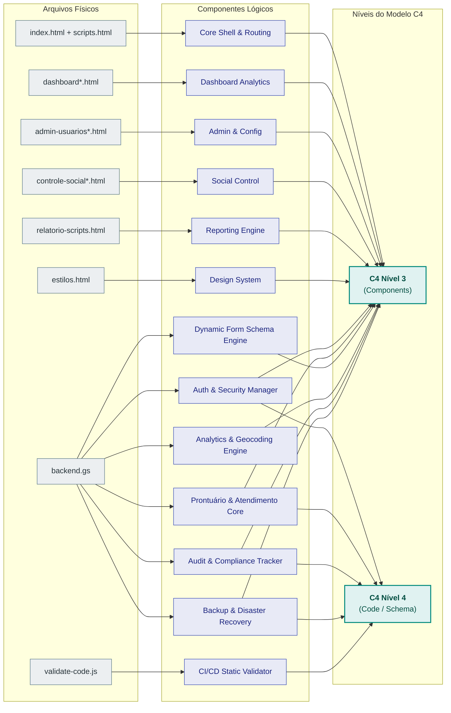
